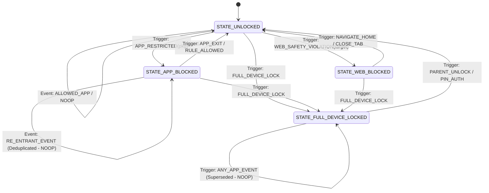

# BLOCKING_STATE_MACHINE.md — MÁQUINA DE ESTADOS Y PRECEDENCIA DEL MOTOR
## FamilyGuard / AppzSegurity Policy & Enforcement Architecture

**Fecha:** 30 de Octubre de 2026  
**Rama:** `fix/android-blocking-stability`  
**Autor:** Senior Android Architect

---

## 1. MÁQUINA DE ESTADOS FINITA (FSM)

El motor de control de ejecución (`EnforcementController`) opera bajo un modelo formal de autómata finito determinista con estados mutuamente excluyentes:



### Definición de Estados

| Estado | ID | Descripción | Interfaz Presentada | Nivel de Bloqueo |
| :--- | :--- | :--- | :--- | :--- |
| **`UNLOCKED`** | `0` | Dispositivo en funcionamiento normal. Ninguna restricción aplicable sobre la ventana activa. | Ninguna (Pantalla normal de Android) | Ninguno |
| **`APP_BLOCKED`** | `1` | El niño abrió o tiene en primer plano una aplicación específica denegada (ej. YouTube, TikTok, juegos). | Overlay / LockActivity con motivo específico: *"Aplicación bloqueada por tus padres"* | Ventana de la aplicación específica |
| **`FULL_DEVICE_LOCKED`** | `2` | El padre activó la Pausa Instantánea o el límite diario de tiempo total se ha agotado. | LockActivity fullscreen persistente + Overlay de máxima prioridad (`TYPE_APPLICATION_OVERLAY`) | Todo el teléfono (excepto emergencias) |
| **`WEB_BLOCKED`** | `3` | Intento de acceso a contenido para adultos, pornografía o dominio explícitamente restringido. | LockActivity con aviso de seguridad web + Alerta en registro de auditoría | Ventana del navegador / WebView |

---

## 2. JERARQUÍA ESTRICTA DE PRECEDENCIA (POLICY PRECEDENCE)

El `PolicyEngine` evalúa cada solicitud de acceso contra la siguiente tabla jerárquica ordenada de mayor a menor prioridad (evaluación en cortocircuito):

```
       [ 1. LISTA BLANCA DE EMERGENCIA Y SISTEMA ]  --> SI COINCIDE -> PERMITIR (Incondicional)
                          │ (No coincide)
                          ▼
       [ 2. PAUSA INSTANTÁNEA GLOBAL DEL DISPOSITIVO ] --> SI ESTÁ ACTIVA -> BLOQUEAR DISPOSITIVO
                          │ (No está activa)
                          ▼
       [ 3. RESTRICCIONES HORARIAS (HORA DE DORMIR/ESCUELA) ] --> SI ESTÁ ACTIVA -> BLOQUEAR POR HORARIO
                          │ (Fuera de horario de restricción)
                          ▼
       [ 4. LÍMITE DIARIO DE TIEMPO AGOTADO ] --> SI SE AGOTÓ -> BLOQUEAR POR CUOTA
                          │ (Queda tiempo disponible)
                          ▼
       [ 5. RESTRICCIÓN MANUAL DE LA APLICACIÓN ] --> SI ESTÁ EN LISTA NEGRA -> BLOQUEAR APP
                          │ (No está en lista negra)
                          ▼
       [ 6. PERMISO POR DEFECTO ] --> PERMITIR
```

### Tabla Detallada de Reglas

| Prioridad | Nivel | Criterio de Evaluación | Acción Resultante |
| :---: | :--- | :--- | :--- |
| **1** | **Emergencia y Sistema Esencial** | Marcador telefónico (`com.android.dialer`, `com.google.android.dialer`, `com.samsung.android.dialer`), llamadas SOS, lanzador de inicio del sistema (Launcher), interfaz del sistema (`com.android.systemui`), pantalla de configuración de PIN de FamilyGuard. | **PERMITIR (ALLOW)** de forma incondicional. Ninguna regla parental puede bloquear llamadas al 911 / 112 / 123. |
| **2** | **Pausa Instantánea del Padre** | `policy.instantLockActive == true` | **BLOQUEAR (BLOCK - FULL_DEVICE)**. Tapa la pantalla completa e impide el uso de cualquier aplicación salvo marcadores de emergencia. |
| **3** | **Horario de Estudio o Sueño** | `policy.isBedtimeActive()` o `policy.isSchoolScheduleActive()` | **BLOQUEAR (BLOCK - SCHEDULE)** para toda aplicación no esencial catalogada como distracción. |
| **4** | **Límite Diario Agotado** | `usedTodayMinutes >= dailyLimitMinutes` | **BLOQUEAR (BLOCK - TIME_LIMIT)**. |
| **5** | **Restricción Manual de App** | `policy.blockedPackages.contains(pkg)` o regla individual = `"blocked"` | **BLOQUEAR (BLOCK - MANUAL_APP)**. Expulsa al inicio y muestra el motivo de aplicación bloqueada. |
| **6** | **Por Defecto** | Ninguna de las condiciones anteriores se cumple. | **PERMITIR (ALLOW)**. El niño puede interactuar normalmente. |

---

## 3. GARANTÍAS DE ESTABILIDAD Y DEDUPLICACIÓN (FLICKER-FREE GUARANTEES)

Para prevenir cualquier efecto de parpadeo o alternancia injustificada:

1. **Deduplicación por Estado Actual**:
   ```java
   if (newDecision.targetState == mCurrentEnforcementState && 
       Objects.equals(newDecision.targetPackage, mCurrentEnforcingPackage)) {
       StructuredLogger.logSkippedDuplicate(newDecision);
       return; // DESCARTAR - No re-aplicar nada, la interfaz ya es estable
   }
   ```
2. **Aislamiento de la Pausa Global respecto a Reglas de Apps**:
   - Cuando el backend reporta `instantLockActive = false`, la máquina de estados hace la transición `FULL_DEVICE_LOCKED -> UNLOCKED`.
   - **PERO** no desbloquea ciegamente si la aplicación que está visible en ese momento es una aplicación individualmente bloqueada:
     ```java
     if (mCurrentEnforcementState == STATE_FULL_DEVICE_LOCKED && !policy.instantLockActive) {
         // Re-evaluar inmediatamente la app en primer plano:
         PolicyDecision currentAppDecision = PolicyEngine.evaluate(foregroundPackage, policy);
         transitionTo(currentAppDecision);
     }
     ```
3. **Serialización de Ejecución (Single-Thread Handler Queue)**:
   - Toda orden de evaluación o cambio de estado se encola obligatoriamente en un `Handler` serializado con `Looper` dedicado.
   - Es matemáticamente imposible que dos hilos cambien el estado de bloqueo simultáneamente.
4. **Descarte de Políticas Obsoletas por Versión Monotónica**:
   - Si `incomingVersion < localPolicyVersion`, el paquete de sincronización se descarta en el acto sin alterar ningún componente visual.
