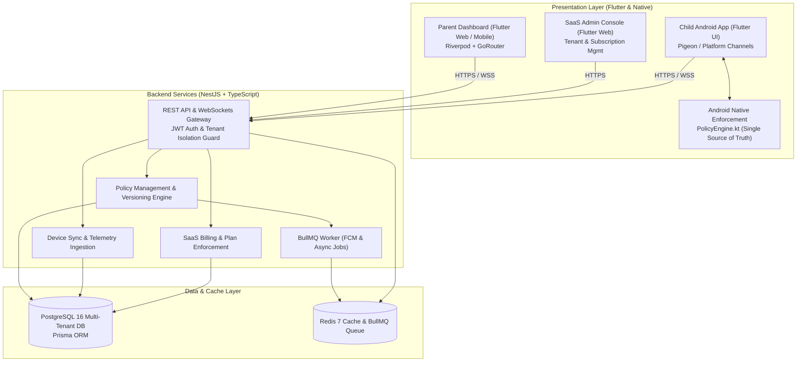

# FamilyGuard 2.0 — Architecture & System Design

## 1. Executive Summary

**FamilyGuard 2.0** is an enterprise-grade parental control and digital wellness SaaS platform. It is engineered from scratch to replace legacy monolithic and brittle approaches with a strictly isolated multi-tenant backend (NestJS, PostgreSQL, Prisma, Redis) and a robust client ecosystem featuring Flutter for multi-platform presentation and a **deterministic, monotonic native Kotlin PolicyEngine** for Android enforcement.

---

## 2. System Architecture Diagram

---

## 3. Core Architectural Principles

### 3.1. Complete Clean-Slate Rebuild
- **Zero Legacy Re-use:** No legacy JSON databases, no hacky background loop scripts, and no unvalidated state machines.
- **Dedicated Branch & Directory:** Fully isolated in `familyguard-v2/` on branch `familyguard-v2`.

### 3.2. Native Android Policy Engine (The Core Differentiator)
Past stability issues (e.g. 1-2s lock/unlock loops, reboot bypasses) stemmed from fragmented decision logic between UI layers and background threads.
In **FamilyGuard 2.0**:
- **Single Source of Truth:** `PolicyEngine.kt` is the sole authority evaluating whether an application is permitted or blocked.
- **Monotonic Versioning:** Every policy update carries an incremental integer `version`. Stale or out-of-order policies (`newVersion <= currentVersion`) are immediately rejected.
- **Strict Precedence Hierarchy:**
  1. *Emergency Dialers & SOS* (Always Allowed, non-negotiable).
  2. *System Permission Essentials* (Prevent Android self-lockout).
  3. *Instant Remote Lock* (Overrules all schedules).
  4. *Bedtime / School Schedules* (Time window restrictions).
  5. *Daily Screen Time Limits* (Quota exhaustion).
  6. *Manual / Category App Blocks* (Individual restrictions).
  7. *Allowed* (Default open state).
- **Persistent State Cache:** Persisted locally in encrypted `SharedPreferences` / Room DB. Policies survive device reboots, airplane mode, and network outages without unlocking windows.

---

## 4. Multi-Tenant Data Architecture (PostgreSQL + Prisma)

- **Family Isolation:** Every family represents a strictly bounded tenant (`Family`).
- **Authorization Guard:** NestJS guards enforce `familyId` ownership on every query. Parents cannot view, modify, or send commands to devices outside their family.
- **Device Fingerprinting:** Every supervised Android phone is bound to a single child via unique installation fingerprints (`deviceFingerprint`), preventing cross-child telemetry bleeding.
- **Auditing:** All critical events (`DEVICE_LOCKED`, `POLICY_CHANGED`, `PIN_OVERRIDE`) generate immutable rows in `AuditLog`.

---

## 5. Deployment Architecture (Coolify + Docker)

- **Isolated Stack:** Deployed as an independent Coolify application without affecting legacy containers or co-hosted services (e.g., Sensei).
- **Private Data Networks:** PostgreSQL and Redis containers communicate exclusively via Docker internal bridge networks without exposing database ports to the public internet.
- **Persistent Volumes:** Named Docker volumes (`familyguard_v2_pgdata`, `familyguard_v2_redisdata`) guarantee 100% data durability across restarts, container rebuilds, and deployments.
- **Health Checks:** Native Docker container health checks ensure smooth zero-downtime rolling updates.
